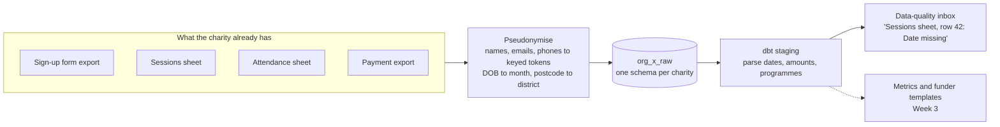

# FunderReady: funder reports from the spreadsheets you already keep

[](https://github.com/chanoch01/funderready/actions/workflows/ci.yml)

FunderReady turns a small charity's sign-up forms, session sheets and payment exports into tested, governed metrics, then fills each funder's report from one set of definitions.

> **Status: Week 1 of 5.** Ingestion, pseudonymisation, a schema per organisation, dbt staging and the first version of the data-quality inbox are working and tested. The metric layer (Week 3), plain-English questions (Week 4) and the app (Week 5) are still to come. See [Roadmap](#roadmap).

## The problem

A youth sports charity has three funders. All three ask for "participants", but one means unique young people, one means attendances, and one counts under-16s only. The numbers live in a Google Form export, a sheet coaches type into, and a payment export. A coordinator spends days copying figures each quarter, and no two reports agree.

31% of charities describe themselves as poor at, or not engaging with, using data ([Charity Digital Skills Report 2025, via Plinth](https://www.plinth.org.uk/complete-guide/attendance-tracking-software-charities)). Existing monitoring tools mostly ask a charity to move its records into their system. FunderReady works on top of what the charity already uses.

## How it works



| Step | Code | What it does |
| --- | --- | --- |
| Generate | [`generator.py`](src/funderready/generator.py) | A synthetic charity with realistic mess: mixed date formats, missing dates of birth, repeat sign-ups with typos, misspelt attendees, amounts typed as words. Every planted problem is recorded in `planted_errors.json` |
| Read | [`sources.py`](src/funderready/sources.py) | Reads CSV exports or a Google Sheet tab shared by link (CSV export URL, no Google credentials). Keeps the spreadsheet row number on every record |
| Pseudonymise | [`pseudonymise.py`](src/funderready/pseudonymise.py) | Keyed HMAC tokens for names, emails and phones; a token of each name's Soundex code so "Jon" and "John" still link; DOB kept to the month; postcode kept to the district |
| Load | [`loader.py`](src/funderready/loader.py) | dlt loads each organisation into its own schema, replacing the previous snapshot |
| Model | [`dbt/`](dbt/) | Staging models parse dates in three formats, amounts with `£` and commas, and inconsistent programme names. `dq_issues` lists every problem as a task |

## Run it

You need Python 3.11+ and Docker.

```bash
python -m venv .venv && source .venv/bin/activate
make setup
cp .env.example .env     # set FUNDERREADY_PSEUDO_KEY before loading real data

make demo                # Postgres + synthetic charity + dbt build
make score               # how many planted problems the inbox found
```

`make test` runs the unit tests, including a full load into DuckDB, without Docker.

To load a real organisation from Google Sheets shared by link:

```bash
funderready load --org "Your Charity" \
  --sheet signups=<sheet-id>:<gid> --sheet sessions=<sheet-id>:<gid> \
  --sheet attendance=<sheet-id>:<gid> --sheet donations=<sheet-id>:<gid>
```

Only do this with the charity's agreement and a data processing agreement in place. Until then, use the synthetic demo.

## Results so far

| Measure | Value | How it was measured |
| --- | --- | --- |
| Unit tests | 29 passing | `pytest`: Soundex against reference codes, token stability, date parsing, CSV and Google Sheets readers, no raw identifiers in loaded records, repeatable DuckDB load |
| dbt checks | 22 passing | `dbt build`: staging tests, the inbox, and a test that fails if any raw-identifier column appears in the warehouse |
| Data-quality inbox | Found 43 of 43 planted problems; 0 tasks on clean rows | `make score` on the seed-7 demo charity (180 children, 78 sessions, 140 donations) |

The inbox score is an upper bound: the generator and the inbox were written together, so real spreadsheets will be messier. CI uses it as a regression test, not as a claim about real data.

## Decisions and trade-offs

1. **Pseudonymise before loading, not in the warehouse.** Raw names never reach Postgres, so a leaked analytics query cannot expose them. The cost: changing what is kept means re-loading from the source sheets.
2. **Phonetic tokens instead of stored names for matching.** A keyed token of each name's Soundex code lets "Jon Smith" match "John Smith" without storing either name. It also merges different people with similar-sounding names, so phonetic matches are used only when they point at exactly one sign-up, and they are flagged for review.
3. **Date of birth kept to the month.** Funders ask for age bands, and a month is precise enough for that. Ages near a band edge can be off by up to a month, which is documented rather than hidden.
4. **One schema per organisation.** No query can mix two charities' data by accident, and deleting a charity is one `DROP SCHEMA`. The trade-off is one dbt run per organisation (`--vars '{org: ...}'`).
5. **Spreadsheet row numbers travel with every record.** Every inbox task says which sheet and row to open, which is what a volunteer needs to fix it.

## Project layout

```
src/funderready/   generator, readers, pseudonymisation, loader, CLI
dbt/               staging and intermediate models, the data-quality inbox, privacy test
scripts/           score_inbox.py: inbox recall against planted problems
tests/             unit tests (no network, no Postgres)
.github/workflows/ CI: lint and tests; demo load, dbt build and inbox score on Postgres
```

## Roadmap

- [x] **Week 1:** messy-data generator, CSV and Google Sheets readers, pseudonymisation, a schema per organisation
- [ ] **Week 2:** people, sessions, attendance and donations models; scored duplicate resolution with precision and recall; 25+ tests *(started: staging, matching and the inbox)*
- [ ] **Week 3:** MetricFlow metrics; three funder templates; PDF export with metric versions
- [ ] **Week 4:** plain-English questions over the metric API only (no generated SQL); 60-question benchmark in CI; Power BI report on the marts
- [ ] **Week 5:** Next.js app with sign-in, row-level security, live comments and a review flow; pilot with a local charity

## Data and privacy

All data in this repository is **synthetic**. Names are random combinations of common first and last names, phone numbers are in Ofcom's drama range, and emails use `example.org`.

Pseudonymised data is still personal data under UK GDPR. Keep `FUNDERREADY_PSEUDO_KEY` secret, restrict warehouse access, and agree retention with each organisation.
