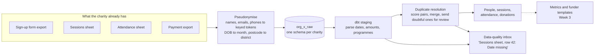

# FunderReady: funder reports from the spreadsheets you already keep

[](https://github.com/chanoch01/funderready/actions/workflows/ci.yml)

FunderReady turns a small charity's sign-up forms, session sheets and payment exports into tested, governed metrics, then fills each funder's report from one set of definitions.

> **Status: Week 2 of 5.** Ingestion, pseudonymisation, scored duplicate resolution, the people / sessions / attendance / donations tables and the data-quality inbox are working and tested, with matching checked on charities it was not tuned on. The metric layer (Week 3), plain-English questions (Week 4) and the app (Week 5) are still to come. See [Roadmap](#roadmap).

## The problem

A youth sports charity has three funders. All three ask for "participants", but one means unique young people, one means attendances, and one counts under-16s only. The numbers live in a Google Form export, a sheet coaches type into, and a payment export. A coordinator spends days copying figures each quarter, and no two reports agree.

31% of charities describe themselves as poor at, or not engaging with, using data ([Charity Digital Skills Report 2025, via Plinth](https://www.plinth.org.uk/complete-guide/attendance-tracking-software-charities)). Existing monitoring tools mostly ask a charity to move its records into their system. FunderReady works on top of what the charity already uses.

## How it works



| Step | Code | What it does |
| --- | --- | --- |
| Generate | [`generator.py`](src/funderready/generator.py) | A synthetic charity with realistic mess: mixed date formats, missing dates of birth, repeat sign-ups with typos, misspelt attendees, amounts typed as words. Every planted problem is recorded in `planted_errors.json` |
| Read | [`sources.py`](src/funderready/sources.py) | Reads CSV exports or a Google Sheet tab shared by link (CSV export URL, no Google credentials). Keeps the spreadsheet row number on every record |
| Pseudonymise | [`pseudonymise.py`](src/funderready/pseudonymise.py) | Keyed HMAC tokens for names, emails and phones; a token of each name's Soundex code so "Jon" and "John" still link; DOB kept to the month; postcode kept to the district |
| Load | [`loader.py`](src/funderready/loader.py) | dlt loads each organisation into its own schema, replacing the previous snapshot |
| Clean | [`dbt/models/staging`](dbt/models/staging) | Parse dates in three formats, amounts with `£` and commas, and inconsistent programme names |
| Resolve | [`dbt/models/intermediate`](dbt/models/intermediate) | Score every plausible pair of sign-ups with Fellegi-Sunter weights, merge confident matches into one person, send doubtful ones to a person, and link attendance names to people |
| Serve | [`dbt/models/marts`](dbt/models/marts) | `dim_people`, `fct_sessions`, `fct_attendance`, `fct_donations`, and `dq_issues`: every problem as a task |
| Score | [`scripts/`](scripts/) | Inbox recall against the planted problems; matching precision and recall against the synthetic ground truth, on the tuning charity and three holdout charities |

## Run it

**Quickest:** open the repo in GitHub Codespaces (Code → Codespaces → Create). The dev container comes with Python and Postgres, so skip `.env` and run `make demo`.

**Locally** you need Python 3.11+, Docker and `make` (on Windows, use WSL).

```bash
python -m venv .venv && source .venv/bin/activate
make setup
cp .env.example .env     # set FUNDERREADY_PSEUDO_KEY before loading real data

make demo                # Postgres + synthetic charity + dbt build
make score               # how many planted problems the inbox found
make match               # duplicate resolution: threshold sweep, precision, recall
make holdout             # the same check on three charities the threshold never saw
```

`make test` runs the unit tests, including a full load into DuckDB, without Docker.

To load a real organisation from Google Sheets shared by link:

```bash
funderready load --org "Your Charity" \
  --sheet signups=<sheet-id>:<gid> --sheet sessions=<sheet-id>:<gid> \
  --sheet attendance=<sheet-id>:<gid> --sheet donations=<sheet-id>:<gid>
```

Only do this with the charity's agreement and a data processing agreement in place. Until then, use the synthetic demo.

## Results so far

| Measure | Value | How it was measured |
| --- | --- | --- |
| Unit tests | 31 passing | `pytest`: Soundex against reference codes, token stability, date parsing, CSV and Google Sheets readers, no raw identifiers in loaded records, ground truth and hard cases in the generator, repeatable DuckDB load |
| dbt tests | 54 data tests and a unit test, all passing | `dbt build`: keys, relationships, accepted values, sign-ups never lost by resolution, no child counted twice per session, a reviewer's decision overriding the score, and a test that fails if any raw-identifier column appears in the warehouse |
| Data-quality inbox | Found 56 of 56 planted problems | `make score` on the seed-7 demo charity (196 sign-ups, 78 sessions, 140 donations). It also raises 5 review tasks on twins, which only a person can tell apart from a repeat sign-up |
| Duplicate resolution, holdout | Pairwise precision 1.000, recall 0.939 | `make holdout`: three charities generated with seeds the threshold was not chosen on (573 sign-ups, 33 true duplicate pairs). 0 wrong merges, 2 missed, and both missed pairs reach the inbox for review |
| Attendance linking, holdout | Precision 1.000, recall 0.9996 | Attendance rows linked to the right child, same three charities |

The generator and the matcher were written together, so these numbers are an upper bound. Real spreadsheets will be messier. CI uses them as regression floors (precision 0.95, recall 0.85 on the holdout charities), not as claims about real data.

### How the match threshold was chosen

Each pair of sign-ups gets a match weight: agreeing on a rare detail (a name, a carer's email) adds a lot, and disagreeing subtracts. The sweep on the demo charity (`make match`):

| Merge pairs scoring at least | Pairs merged | Precision | Recall |
| --- | --- | --- | --- |
| 4 | 22 | 0.727 | 1.000 |
| 12 | 21 | 0.762 | 1.000 |
| **14** | **16** | **1.000** | **1.000** |
| 18 | 14 | 1.000 | 0.875 |
| 24 | 13 | 1.000 | 0.812 |

Below 14, twins get merged: they share a carer, a birth month, a postcode and a programme, and differ only in name. Above 16, real repeat sign-ups start to be missed. 14 sits in that gap. Pairs scoring between 4 and 14 are not merged; they go to the inbox as "Twins, or a repeat sign-up?" and the answer is stored (see decision 8).

<!-- Exercise 3: replace this comment with your own explanation of the threshold and the two missed pairs. See exercises/WEEK2.md -->

## Decisions and trade-offs

1. **Pseudonymise before loading, not in the warehouse.** Raw names never reach Postgres, so a leaked analytics query cannot expose them. The cost: changing what is kept means re-loading from the source sheets.
2. **Phonetic tokens instead of stored names for matching.** A keyed token of each name's Soundex code lets "Jon Smith" match "John Smith" without storing either name. It also merges different people with similar-sounding names, so phonetic matches are used only when they point at exactly one sign-up, and they are flagged for review.
3. **Date of birth kept to the month.** Funders ask for age bands, and a month is precise enough for that. Ages near a band edge can be off by up to a month, which is documented rather than hidden.
4. **One schema per organisation.** No query can mix two charities' data by accident, and deleting a charity is one `DROP SCHEMA`. The trade-off is one dbt run per organisation (`--vars '{org: ...}'`).
5. **Spreadsheet row numbers travel with every record.** Every inbox task says which sheet and row to open, which is what a volunteer needs to fix it.
6. **Fellegi-Sunter scoring instead of hand-written rules.** Each feature's weight is `log2(m/u)`: `m` (how often it agrees for the same child) is a stated assumption in [`match_parameters.csv`](dbt/seeds/match_parameters.csv), and `u` (how often it agrees by chance) is measured from the data. This is the model behind Splink. Its weakness is that it assumes features are independent; carer email and phone are not, so they are combined into one feature rather than counted twice.
7. **Blocking sets the ceiling on recall.** Only pairs sharing a phonetic name, a carer contact, or a birth month plus postcode are compared at all. The third rule was added after an early holdout check showed a typo ("Lly" for "Lily") changing the Soundex code on a form the other parent filled in, so that pair was never compared. The case is rare: across 40 generated charities the rule brings 1 of 444 true duplicate pairs into comparison, at the cost of a few dozen extra candidate pairs.
8. **Three outcomes, not two.** Confident matches merge, doubtful ones go to a person, and the rest stay separate. A reviewer's answer is stored in [`match_decisions.csv`](dbt/seeds/match_decisions.csv) against the two name tokens, not row numbers, so it survives re-sorting and reloads.
9. **A wrong link is worse than no link.** An attendance name is linked only when it points at exactly one child (phonetic matches only within the same programme). An unlinked row shows up in the inbox; a wrong link silently counts one child's attendance as another's.
10. **The threshold was chosen on one charity and checked on three others.** Picking the threshold on the same data you report on flatters the result: the demo charity scores a perfect 1.000 and the holdout charities score 0.939 recall.

## Project layout

```
src/funderready/   generator, readers, pseudonymisation, loader, CLI
dbt/models/        staging -> intermediate (matching) -> marts; exercises/ for pair-build tasks
dbt/seeds/         match parameters and reviewers' match decisions
dbt/tests/         singular tests: privacy, resolution integrity, no double counting
scripts/           score_inbox.py, score_matching.py (sweep, precision/recall, holdout)
tests/             unit tests (no network, no Postgres)
exercises/         this week's pair-build brief
.devcontainer/     Codespaces: Python + Postgres, nothing to install
.github/workflows/ CI: lint and tests; demo load, dbt build, inbox and holdout matching scores
```

## Roadmap

- [x] **Week 1:** messy-data generator, CSV and Google Sheets readers, pseudonymisation, a schema per organisation
- [x] **Week 2:** people, sessions, attendance and donations models; scored duplicate resolution with precision and recall on holdout charities; 25+ tests
- [ ] **Week 3:** MetricFlow metrics; three funder templates; PDF export with metric versions
- [ ] **Week 4:** plain-English questions over the metric API only (no generated SQL); 60-question benchmark in CI; Power BI report on the marts
- [ ] **Week 5:** Next.js app with sign-in, row-level security, live comments and a review flow; pilot with a local charity

## Data and privacy

All data in this repository is **synthetic**. Names are random combinations of common first and last names, phone numbers are in Ofcom's drama range, and emails use `example.org`.

Pseudonymised data is still personal data under UK GDPR. Keep `FUNDERREADY_PSEUDO_KEY` secret, restrict warehouse access, and agree retention with each organisation.
